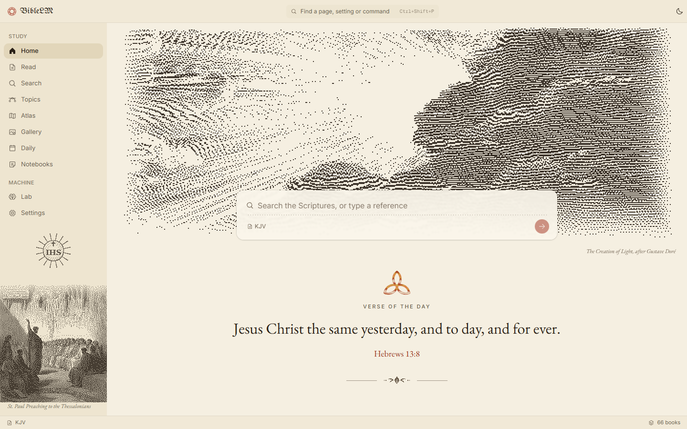

<p align="center">
  
</p>

<h1 align="center">BibleLM</h1>

<p align="center">
  An illustrated Bible study tool, with a language model trained from scratch inside it.
</p>

<p align="center"><sub>Tauri 2 · React 19 · @nexis/design · transformers.js · PyTorch or Axon</sub></p>

<p align="center">
  <a href="https://github.com/rwetz/biblelm/actions/workflows/ci.yml"></a>
  <a href="https://github.com/rwetz/biblelm/releases/latest"></a>
  <a href="LICENSE"></a>
</p>



BibleLM is two things in one window. A **study Bible**: six public-domain
translations and 1 Enoch, all 241 of Gustave Doré's 1866 Bible engravings
set beside the verses they depict, with woodcuts by Dürer, Blake and others,
and paintings by Caravaggio and his followers. It also has cross references,
a topical index, search by meaning, an atlas, the Daily Office, the Hebrew and
Greek interlinear, and notebooks for your own studies. And a **lab**: a small
GPT you train from scratch on Scripture and can look inside, layer by layer.

The rule throughout: **the machine finds, Scripture speaks.** Every ML feature
returns real verses with their references. Anything generated is labelled, and
never shown as Scripture.

## Study

| Page | What it does |
|---|---|
| **Home** | Verse of the day in blackletter, under a dithered scene that follows the church year |
| **Read** | Any chapter in KJV (with the 1611 Apocrypha), WEB, ASV, Douay-Rheims, Brenton Septuagint or the Vulgate; red letter, parallel and two-column reading, an interlinear mode with the Hebrew and Greek; plates at their verses and paintings as frontispieces; tap a verse (or ctrl and shift click several) for cross references, topics, Strong's words, similar verses, a word-level comparison across translations, the people and places it names, and your notes |
| **Search** | A reference, a word, a Strong's number, a question ("how many times does grace appear"), or what you mean in your own words ("when I feel anxious"), matched by a small embedding model that runs on your computer |
| **Topics** | 6,712 topics; *study walks* (personalised PageRank over 341,000 cross references); the strongest chain between two passages; a map of every verse placed by meaning; a chiasm finder; words (tf-idf, collocations, style); links and communities; echoes of the Old Testament in the New; studies for young men fighting temptation |
| **Atlas** | An engraved map of every geocoded place, the people with their families, and a timeline of the eras |
| **Gallery** | Every picture in Bible order; **Look** shows one full window beside its passage |
| **Daily** | The Daily Office from the 1979 Book of Common Prayer, reading plans, and verses by heart on spaced repetition |
| **Notebooks** | One per study, each with its own translations, canon and cover plate; notes on a verse or several, anchored so they follow the text into every translation; Markdown export by notebook, book or chapter; print illustrated; merge a copy from another machine; daily backups |

Canon is a shelf: the Protestant 66 by default; the Deuterocanon, the
Apocrypha and the Pseudepigrapha (1 Enoch, R. H. Charles, 1917) are a switch
away, always marked, never mixed into your results.

## Lab

Train a 10.8M-parameter character-level GPT on any Bible translation and watch
the loss fall live; generate KJV-sounding text (clearly labelled); export to
ONNX; and look inside: every attention head, the logit lens (the model's guess
after each layer), and which real verses surprise it most. Lessons cover
Zipf's law and why "Bible codes" turn up in Moby-Dick too. The Lab trains with
Python and PyTorch, or with [Axon](https://github.com/rwetz/axon) 0.11 (no
Python) when it is installed; nothing else in the app needs either.

## Optional machine help

- **Jev** (TypeSafe): routes queries and reranks results with bounded
  judgments, using `TYPESAFE_API_KEY` from your own environment.

No large hosted model is used: everything else runs on your computer.

## Download

Installers for Windows and macOS are on the
[latest release](https://github.com/rwetz/biblelm/releases/latest) (v2.1.0).
The 2.x roadmap is complete; see [docs/ROADMAP.md](docs/ROADMAP.md) and the
[CHANGELOG](CHANGELOG.md).

## Run it

```sh
pnpm install
pnpm data          # builds texts, plates and the semantic index (a few minutes, once)
pnpm dev           # the study app, in a browser
pnpm tauri dev     # the desktop app, with the Lab
```

For the Lab, add a Python 3.13 venv at `.venv` with `python/requirements.txt`
and a PyTorch build (CUDA recommended). See [docs/DATA.md](docs/DATA.md) and
[AGENTS.md](AGENTS.md).

## Credits

Texts: public domain, from [eBible.org](https://ebible.org); 1 Enoch from
[Project Gutenberg](https://www.gutenberg.org/ebooks/77935). Cross references,
topics and places: [OpenBible.info](https://www.openbible.info), CC-BY. People
and the interlinear: [STEPBible](https://www.stepbible.org), CC BY 4.0.
Illustrations: Gustave Doré, *La Grande Bible de Tours* (1866), public domain,
via Wikimedia Commons ([list](docs/art-credits.md)); woodcuts
([list](docs/woodcut-credits.md)) and paintings
([list](docs/painting-credits.md)), public domain or CC0. Embeddings: BAAI bge-small-en-v1.5 (MIT).
Strong's dictionaries: [Open Scriptures](https://github.com/openscriptures/strongs), CC-BY-SA.
Faces: UnifrakturMaguntia, Grenze Gotisch, IM Fell English, EB Garamond (OFL).

## License

[MIT](LICENSE).

## Keys

| Keys | |
|---|---|
| <kbd>Ctrl</kbd>+<kbd>Shift</kbd>+<kbd>P</kbd> | Command palette |

---

<p align="center">
  <picture>
    <source media="(prefers-color-scheme: dark)" srcset="docs/brand/heptagram-white.svg">
    
  </picture>
</p>
